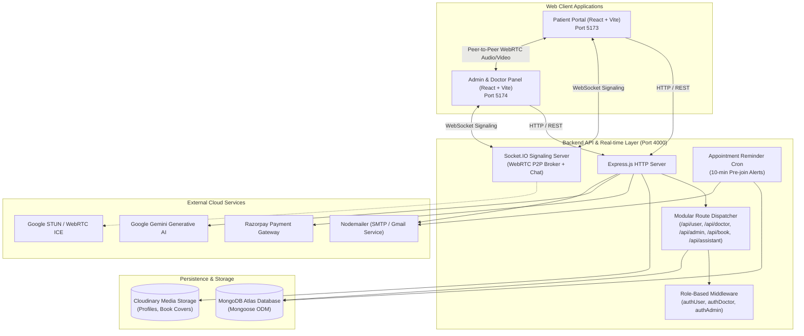
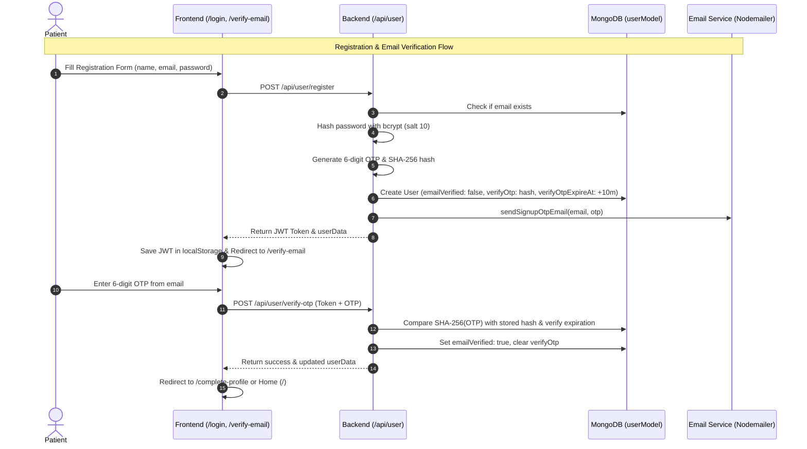
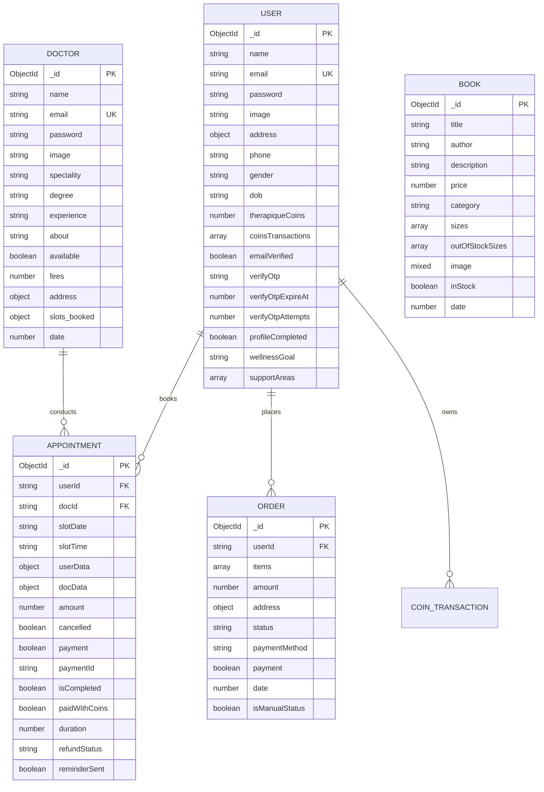

# 🏛️ Therapique Platform — System Architecture & Technical Specification

> **Target Audience:** Developers, Technical Leads, System Architects, and AI Coding Assistants.  
> **Repository:** `Therapique` (MERN + WebRTC + Socket.IO + Google Gemini AI)

---

## 📑 Table of Contents
1. [Executive System Overview](#1-executive-system-overview)
2. [High-Level Architecture & Topology](#2-high-level-architecture--topology)
3. [Technology Stack Matrix](#3-technology-stack-matrix)
4. [Monorepo & Workspace Layout](#4-monorepo--workspace-layout)
   - [4.1 Root & Monorepo Directories](#41-root--monorepo-directories)
   - [4.2 Backend Directory Structure (`/backend`)](#42-backend-directory-structure-backend)
   - [4.3 Patient Frontend Directory Structure (`/frontend`)](#43-patient-frontend-directory-structure-frontend)
   - [4.4 Operations & Doctor Admin Directory Structure (`/admin`)](#44-operations--doctor-admin-directory-structure-admin)
5. [Core Subsystems & Technical Workflows](#5-core-subsystems--technical-workflows)
   - [5.1 Authentication, Identity & OTP Verification](#51-authentication-identity--otp-verification)
     - [5.1.1 Animated OTP Verification Engine](#511-animated-otp-verification-engine)
     - [5.1.2 Platform OTP Footprint](#512-platform-otp-footprint)
   - [5.2 Telehealth & WebRTC Real-Time Video Engine](#52-telehealth--webrtc-real-time-video-engine)
   - [5.3 Appointment Scheduling & Slot Engine](#53-appointment-scheduling--slot-engine)
   - [5.4 Curated Bookstore & Order Lifecycle](#54-curated-bookstore--order-lifecycle)
   - [5.5 Gamified Coin Economy & Wallet System](#55-gamified-coin-economy--wallet-system)
   - [5.6 AI Conversational Assistant (Gemini)](#56-ai-conversational-assistant-gemini)
   - [5.7 Automated Email & Reminder Daemons](#57-automated-email--reminder-daemons)
6. [Data Architecture & Schemas (MongoDB / Mongoose)](#6-data-architecture--schemas-mongodb--mongoose)
7. [REST API Surface & Endpoint Catalog](#7-rest-api-surface--endpoint-catalog)
8. [Client-Side Architecture & State Management](#8-client-side-architecture--state-management)
9. [Environment Variables & Configuration](#9-environment-variables--configuration)
10. [Conventions & Developer/AI Cheatsheet](#10-conventions--developerai-cheatsheet)

---

## 1. Executive System Overview

**Therapique** is a full-stack telehealth, mental health, and psycho-educational web platform. It unifies clinical therapy workflows with digital commerce and AI-guided mental health discovery:

1. **Patient Web Application (`/frontend`)**: Allows patients to explore verified mental health professionals, book appointments, engage in secure 1-on-1 WebRTC video consultations, browse a curated therapeutic bookstore, earn and spend reward tokens, and interact with an in-house AI assistant.
2. **Provider & Admin Management Suite (`/admin`)**: A dual-role administrative application serving both **Platform Administrators** (managing doctors, book inventory, platform orders, and system statistics) and **Therapists/Doctors** (managing consultation schedules, participating in video calls, and viewing clinical case histories).
3. **Core API Server (`/backend`)**: An Express.js microservice backed by MongoDB, hosting REST APIs, a Socket.IO WebRTC signaling relay, automated reminder daemons, Razorpay payment processing, and Google Gemini AI integration.

---

## 2. High-Level Architecture & Topology



---

## 3. Technology Stack Matrix

| Domain | Technology / Library | Purpose & Details |
|---|---|---|
| **Frontend Framework** | React 18 (Vite) | Single-Page Application (SPA) with fast HMR |
| **Styling & Icons** | Tailwind CSS + Lucide React | Modern glassmorphism, responsive utilities, icons |
| **State Management** | React Context API | Domain-level separation (`AppContext`, `ShopContext`, `AdminContext`, `DoctorContext`) |
| **Backend Runtime** | Node.js (ES Modules) | High-performance asynchronous runtime |
| **Web Framework** | Express 4.x + Compression | REST API with Gzip/Brotli compression middleware |
| **Real-time Protocol** | Socket.IO 4.x | WebRTC signaling relay, user presence, in-call chat |
| **Video Telehealth** | WebRTC API | Browser-native peer-to-peer audio/video mesh with STUN |
| **Database & ODM** | MongoDB + Mongoose 8.x | Document database with compound partial unique indexes |
| **AI LLM Engine** | `@google/generative-ai` | Gemini 2.5 Flash / Flash-Lite clinical conversational assistant |
| **Authentication** | JWT + bcrypt + crypto SHA-256 | Stateless tokens, salt hashing, 6-digit OTP verification |
| **Payment Gateway** | Razorpay SDK | Secure online transactions for appointments and books |
| **Email Transport** | Nodemailer | Transactional emails with responsive HTML templates |
| **Media Storage** | Cloudinary SDK + Multer | Cloud storage for doctor photos, avatars, book covers |

---

## 4. Monorepo & Workspace Layout

```
Therapique/
├── ARCHITECTURE.md          # Comprehensive System Architecture Guide (This file)
├── README.md                # Project introduction & quick-start guide
├── package.json             # Root workspace coordination
├── backend/                 # Node.js + Express REST API & WebRTC Signaling Server (Port 4000)
├── frontend/                # Patient-facing React 18 SPA (Port 5173)
└── admin/                   # Operations & Clinical Management Suite (Port 5174)
```

### 4.1 Root & Monorepo Directories

| Directory / File | Description & Purpose |
|---|---|
| `backend/` | Microservice server powering REST APIs, WebRTC Socket.IO signaling, cron reminder daemons, Razorpay payment capture, and Google Gemini AI integration. |
| `frontend/` | Client-facing telehealth portal where patients discover therapists, book sessions, join encrypted WebRTC calls, purchase therapeutic literature, and earn reward coins. |
| `admin/` | Operations portal providing role-segregated dashboards for Platform Administrators (analytics, inventory, orders, doctor credentials) and Therapists (schedules, patient consults). |
| `cloudflared.exe` | Optional secure tunneling utility for exposing localhost webhooks or remote testing. |
| `ARCHITECTURE.md` | Primary architectural specification and technical manual for developers and AI agents. |
| `README.md` | High-level overview, feature summary, and local environment bootstrapping steps. |

---

### 4.2 Backend Directory Structure (`/backend`)

The backend follows an Express MVC architecture augmented with service layers, background daemons, and a real-time WebSocket broker:

```
backend/
├── config/                  # Infrastructure & external service connectors
│   ├── mongodb.js           # Mongoose connection pooling & event listeners
│   ├── cloudinary.js        # Cloudinary media bucket configuration
│   └── nodemailer.js        # SMTP transporter & connection verifier
├── constants/               # Immutable business logic constants
│   └── coinPackages.js      # Gamified token pricing & bundle tiers
├── controllers/             # Request handlers & business domain controllers
│   ├── adminController.js   # Platform KPIs, doctor onboarding, credentials
│   ├── assistantController.js# Gemini AI conversational agent & rate limiter
│   ├── bookController.js    # Bookstore catalog, stock management, orders
│   ├── doctorController.js  # Clinical schedules, consultation tickets, profile
│   └── userController.js    # Auth, OTP, appointment booking, payments, coins
├── middlewares/             # Express HTTP request filters & auth guards
│   ├── authAdmin.js         # Decodes and validates Platform Administrator JWTs
│   ├── authDoctor.js        # Decodes and validates Therapist/Doctor JWTs
│   ├── authUser.js          # Decodes and validates Patient/User JWTs
│   └── multer.js            # Disk storage preprocessor for file uploads
├── models/                  # Mongoose document schemas & compound indexes
│   ├── appointmentModel.js  # Consultation records, slot keys, payment states
│   ├── bookModel.js         # Book metadata, multi-format stocks (Hardcover, Paperback, E-book)
│   ├── contactModel.js      # Inbound patient support inquiries
│   ├── doctorModel.js       # Doctor credentials, specialties, schedules, bio
│   ├── newsletterModel.js   # Email marketing subscription registry
│   ├── orderModel.js        # Bookstore transactions, shipping, payment methods
│   └── userModel.js         # Patient identities, coin balances, OTP hashes
├── routes/                  # Express REST route dispatchers
│   ├── adminRoutes.js       # Admin API routes (/api/admin)
│   ├── assistantRoutes.js   # AI chatbot API routes (/api/assistant)
│   ├── bookRoutes.js        # Bookstore & order routes (/api/book)
│   ├── doctorRoutes.js      # Clinical provider routes (/api/doctor)
│   └── userRoutes.js        # Patient auth, booking, & profile routes (/api/user)
├── scripts/                 # Standalone maintenance & batch migration scripts
│   └── uploadBooksToCloudinary.js # Seeding utility to upload bookstore imagery
├── services/                # Asynchronous background engines
│   ├── emailService.js      # 13+ branded transactional HTML email templates
│   └── appointmentReminderService.js # Cron daemon running 10-min pre-join alerts
├── socket/                  # WebRTC P2P signaling relay & Socket.IO server
│   ├── index.js             # Socket.IO initialization with Express HTTP server
│   ├── socketAuth.js        # Handshake token authentication & role tagging
│   ├── videoCallHandler.js  # WebRTC Offer/Answer/ICE relay, room joins, chat
│   ├── callSessionManager.js# Active in-memory consultation session registry
│   └── callTicketManager.js # Ephemeral cryptographic room access tickets
├── utils/                   # Shared algorithmic utilities & canonical helpers
│   └── appointmentTiming.js # Canonical slot formatters & collision detection
└── server.js                # Main application bootstrap & HTTP listener
```

#### Detailed Backend Folder Responsibilities:
* **`config/`**: Centralizes external API keys and connection pooling. `mongodb.js` initializes MongoDB with resilient retry logic. `cloudinary.js` wraps image uploads for avatars and book covers. `nodemailer.js` sets up SMTP transport with DKIM/TLS verification.
* **`constants/`**: Holds static platform definitions, such as `coinPackages.js` which defines token bundles (e.g. 100 coins for ₹99) and reward multipliers.
* **`controllers/`**: Isolates all business operations. `userController.js` handles registration, SHA-256 OTP hashing, slot locking, and Razorpay signature validation. `assistantController.js` enforces sliding-window rate limiting before sending patient prompts to Google Gemini. `bookController.js` handles stock decrements and multi-item orders.
* **`middlewares/`**: Implements defense-in-depth authorization. Verifies JWT bearer tokens against distinct secret signatures, attaching `req.userId`, `req.doctorId`, or admin credentials to requests.
* **`models/`**: Defines schema validation rules, default fields, and unique indexes. Noticeably, `appointmentModel.js` maintains slot status and WebRTC join windows, while `userModel.js` tracks OTP security fields (`verifyOtp`, `verifyOtpExpireAt`, `verifyOtpAttempts`).
* **`routes/`**: Maps clean REST URL patterns to controller methods, injecting appropriate auth middlewares and Multer file parsers.
* **`scripts/`**: Contains offline administrative utilities, such as batch uploading book covers to Cloudinary and generating seed JSON data.
* **`services/`**: Encapsulates external I/O workflows. `emailService.js` contains styled HTML templates for welcome emails, appointment bookings, cancellation alerts, refund notices, and OTP codes. `appointmentReminderService.js` runs a standing 1-minute interval checking for appointments starting in exactly 10 minutes to dispatch alerts.
* **`socket/`**: Serves as the real-time heartbeat of the telehealth platform. Handles peer discovery, WebRTC SDP offer/answer exchanges, ICE candidate multiplexing, and in-call live chat without persisting ephemeral streams.
* **`utils/`**: Houses deterministic mathematical and date algorithms. `appointmentTiming.js` normalizes time strings (e.g. `"10:00 AM"` vs `"10:0"`), evaluates whether a consultation is within its 10-minute join window, and detects overlapping slots.

---

### 4.3 Patient Frontend Directory Structure (`/frontend`)

The frontend is an optimized Vite + React Single-Page Application (SPA) styled with Tailwind CSS and animated with Framer Motion:

```
frontend/
├── public/                  # Static assets (favicons, browser manifest)
└── src/
    ├── assets/              # Curated SVG icons, logos, clinical photography
    ├── components/          # Reusable UI component library
    │   ├── blog/            # Blog widgets (cards, category filters, articles)
    │   ├── ui/              # Atom/molecule primitives (dropdowns, cards, banners)
    │   ├── videocall/       # Telehealth stream viewports, controls, chat dock
    │   ├── Navbar.jsx       # Global responsive header with coin balance badge
    │   ├── Footer.jsx       # Platform footer, newsletter, legal links
    │   ├── Hero.jsx         # Animated landing hero with dynamic CTA
    │   ├── TherapiqueAssistant.jsx # In-app floating AI mental health assistant
    │   ├── CartTotal.jsx    # Bookstore checkout calculator & coin discounts
    │   ├── ReceiptModal.jsx # Visual printable invoice & order receipt modal
    │   └── TopDoctors.jsx   # Curated list of verified clinical practitioners
    ├── constants/           # Route name declarations (routes.js)
    ├── context/             # React Context global state providers
    │   ├── AppContext.jsx   # Auth tokens, user profile, doctor catalog, coins
    │   └── ShopContext.jsx  # Bookstore state, cart persistence, token redemption
    ├── data/                # In-memory datasets & search bridges
    │   ├── assistantDataBridge.js # Connects AI assistant with live doctor catalog
    │   ├── blogData.js      # Mental health psycho-educational articles
    │   └── data.js          # Fallback book catalogs & mock data
    ├── hooks/               # Stateful custom React hooks
    │   ├── useWebRTC.js     # Native RTCPeerConnection lifecycle & media tracks
    │   ├── useSocket.js     # Shared Socket.IO client instance & listeners
    │   ├── useCallSignaling.js # Telehealth room negotiation & join validation
    │   └── useClickOutside.js# Modal and dropdown backdrop dismissal
    ├── pages/               # Top-level view routes
    │   ├── Home.jsx         # Landing page with hero, categories, top doctors
    │   ├── Doctors.jsx      # Filterable specialist directory by clinical modality
    │   ├── Appointments.jsx # Doctor booking interface with slot selector
    │   ├── MyAppointments.jsx # Patient appointment ledger & video join portal
    │   ├── VideoCallPage.jsx# Full-screen WebRTC video consultation room
    │   ├── Shop.jsx         # Curated psycho-educational literature store
    │   ├── ProductDetail.jsx# Multi-format book view (Hardcover, Paperback, eBook)
    │   ├── Cart.jsx         # Shopping cart with token discount application
    │   ├── TrackOrder.jsx   # Visual shipping tracker for bookstore orders
    │   ├── MyOrders.jsx     # Order history with downloadable PDF receipts
    │   ├── CoinsShop.jsx    # Reward coin store & wallet replenishment
    │   ├── Blog.jsx         # Educational mental health articles & guides
    │   ├── About.jsx        # Mission statement, clinical methodology, founders
    │   ├── Contact.jsx      # Inbound support and clinical enquiry form
    │   ├── Login.jsx        # Patient login, signup, and forgot password modal
    │   ├── VerifyEmail.jsx  # 6-box sliding OTP verification animation
    │   ├── CompleteProfile.jsx # New patient clinical onboarding questionnaire
    │   └── MyProfile.jsx    # Patient account settings & profile management
    ├── utils/               # Client-side helper functions
    │   ├── appointmentTiming.js # Slot validation & join countdown calculator
    │   ├── dateFormatter.js # Localized human-readable date formatting
    │   ├── imageHelper.js   # Cloudinary dynamic resizing & fallback images
    │   └── loadRazorpay.js  # Async dynamic SDK loader for Razorpay checkout
    ├── App.jsx              # Main routing tree, layout wrappers, & RouteGuards
    ├── index.css            # Global CSS variables, custom scrollbars, typography
    └── main.jsx             # React DOM root bootstrapping
```

#### Detailed Frontend Folder Responsibilities:
* **`assets/`**: High-resolution SVG vectors, specialty illustrations (CBT, Trauma, Child Therapy), doctor photos, and branding logos.
* **`components/`**: Modular, highly reusable presentation components. `components/videocall/` isolates WebRTC video rendering, audio wave animations, media device pickers, and in-call text chat. `TherapiqueAssistant.jsx` provides the floating AI chat window with speech/text input.
* **`context/`**: Contains the application's global state. `AppContext.jsx` stores the JWT token, current user object, unread appointment counts, and doctor lists. `ShopContext.jsx` manages cart state (with `localStorage` caching), subtotal calculations, and token discount deductions.
* **`hooks/`**: Encapsulates complex side-effectful logic. `useWebRTC.js` manages local media constraints (camera/mic), handles ICE negotiation, and attaches remote media streams to video elements.
* **`pages/`**: Corresponds directly to React Router endpoints. Special highlights include [`VerifyEmail.jsx`](file:///c:/Users/rishab/Downloads/Projects/Therapique/frontend/src/pages/VerifyEmail.jsx) featuring the custom 6-box inward-sliding OTP animation, and [`MyAppointments.jsx`](file:///c:/Users/rishab/Downloads/Projects/Therapique/frontend/src/pages/MyAppointments.jsx) which computes dynamic 10-minute countdowns enabling the "Join Video Call" button.
* **`utils/`**: Reusable math and UI helpers. `loadRazorpay.js` dynamically inserts the external Razorpay checkout script on demand to keep bundle sizes lean.

---

### 4.4 Operations & Doctor Admin Directory Structure (`/admin`)

The admin suite is an independent React application tailored for clinical staff and system administrators:

```
admin/
├── public/                  # Admin portal static favicons and assets
└── src/
    ├── assets/              # Administrative icons, action badges, logos
    ├── components/          # Specialized admin UI components
    │   ├── ui/              # Admin-themed form controls, modal frames, badges
    │   ├── videocall/       # Doctor-side WebRTC stream viewport & dock
    │   ├── Navbar.jsx       # Admin/Doctor status header & logout trigger
    │   ├── Sidebar.jsx      # Role-filtered navigational menu (Admin vs Doctor)
    │   ├── DonutChart.jsx   # Financial & appointment visual analytics chart
    │   ├── IncomingCallModal.jsx # Real-time ringing popup for patient calls
    │   ├── AppointmentDetailsModal.jsx # Full clinical case history popup
    │   └── ImageCropperModal.jsx # Avatar and doctor profile photo crop utility
    ├── context/             # Multi-role administrative contexts
    │   ├── AdminContext.jsx # Platform KPIs, doctor onboarding, all bookings
    │   ├── DoctorContext.jsx# Clinical schedule, active calls, earnings summary
    │   └── AppContext.jsx   # Shared currency formatting and date normalizers
    ├── hooks/               # Doctor-specific real-time hooks
    │   ├── useDoctorSocket.js # WebSocket client listening for incoming calls
    │   ├── useSocket.js     # Shared admin socket connection
    │   └── useWebRTC.js     # Doctor WebRTC peer connection manager
    ├── pages/               # Role-segmented management views
    │   ├── Admin/           # Platform Administrator Screens
    │   │   ├── Dashboard.jsx        # System KPIs, revenue graphs, latest bookings
    │   │   ├── AddDoctor.jsx        # Doctor onboarding form with Cloudinary upload
    │   │   ├── DoctorsList.jsx      # Doctor directory with availability toggling
    │   │   ├── AllAppointments.jsx  # Master appointment roster & payment states
    │   │   ├── AddBook.jsx          # Book inventory creation with format pricing
    │   │   ├── BookList.jsx         # Catalog management & stock editor
    │   │   └── BookOrders.jsx       # Order fulfillment, tracking ID assignment
    │   ├── Doctor/          # Therapist / Clinical Provider Screens
    │   │   ├── DoctorDashboard.jsx  # Daily schedule, upcoming sessions, earnings
    │   │   ├── DoctorAppointments.jsx # Doctor-specific appointment list & call launcher
    │   │   └── DoctorProfile.jsx    # Doctor biography, consultation fees, hours
    │   └── Login.jsx        # Dual-toggle login screen (Admin vs Doctor)
    ├── utils/               # Slot timing and join window validation engine
    │   └── appointmentTiming.js # Canonical slot engine
    ├── App.jsx              # Role-aware layout router with auth switches
    ├── index.css            # Admin CSS design system & data table styling
    └── main.jsx             # Admin React entry point
```

#### Detailed Admin Folder Responsibilities:
* **`components/`**: Built for operational efficiency. `IncomingCallModal.jsx` displays an urgent audible ringing modal when a patient enters the telehealth room. `DonutChart.jsx` visualizes appointment completion rates and revenue breakdown.
* **`context/`**: Separates admin domain from doctor domain. `AdminContext.jsx` manages platform-wide administrative functions (approving doctors, reviewing store orders). `DoctorContext.jsx` handles therapist-centric data (toggling online availability, viewing patient clinical notes).
* **`pages/Admin/`**: Dedicated to system maintenance. Includes inventory stock adjustments, shipment status tracking (`Order Placed` ➔ `Shipped` ➔ `Out for Delivery` ➔ `Delivered`), and doctor profile reviews.
* **`pages/Doctor/`**: Designed for clinical ease. Therapists can launch WebRTC consultations with a single click, view previous patient appointment notes, and manage their working hours.
* **`pages/Login.jsx`**: Features a unified dual-toggle tab (`Admin` or `Doctor`) directing credentials to either `/api/admin/login` (environment credentials) or `/api/doctor/login` (MongoDB doctor account).

---

## 5. Core Subsystems & Technical Workflows

### 5.1 Authentication, Identity & OTP Verification



#### Key Auth Implementation Notes:
1. **Password Security**: Standard `bcrypt.genSalt(10)` hashing.
2. **OTP Architecture**:
   - The plain OTP is **never** stored in the database. Only its `crypto.createHash('sha256')` hexadecimal digest is stored.
   - OTP validity: 10 minutes (`verifyOtpExpireAt`).
   - Rate limit protection: Max 5 failed attempts (`verifyOtpAttempts >= 5` locks the OTP).
   - Cooldown protection: 60-second cooldown between resend requests (`verifyOtpLastSentAt`).
3. **Role Segregation**:
   - Patient tokens sign `{ id: user._id }` using `process.env.JWT_SECRET`. Verified by [`authUser.js`](file:///c:/Users/rishab/Downloads/Projects/Therapique/backend/middlewares/authUser.js).
   - Doctor tokens sign `{ id: doctor._id }` using `process.env.JWT_SECRET`. Verified by [`authDoctor.js`](file:///c:/Users/rishab/Downloads/Projects/Therapique/backend/middlewares/authDoctor.js).
   - Admin tokens encode the admin credential combination using `process.env.JWT_SECRET`. Verified by [`authAdmin.js`](file:///c:/Users/rishab/Downloads/Projects/Therapique/backend/middlewares/authAdmin.js).

#### 5.1.1 Animated OTP Verification Engine ([`VerifyEmail.jsx`](file:///c:/Users/rishab/Downloads/Projects/Therapique/frontend/src/pages/VerifyEmail.jsx) & [`VerifyEmail.css`](file:///c:/Users/rishab/Downloads/Projects/Therapique/frontend/src/pages/VerifyEmail.css))
The email verification page features an interactive multi-box choreography adapted to Therapique's emerald-and-cream design system:
* **Geometry & Symmetrical Inward Slide**:
  - Automatically calculates responsive box pitch: `pitch = isMobile ? 52 : 64` px.
  - Symmetrical movement vectors into center Box 0:
    - Box 0: Moves `+2.5 * pitch` (Right to dead center).
    - Box 1: Moves `+1.5 * pitch` (Right to center).
    - Box 2: Moves `+0.5 * pitch` (Right to center).
    - Box 3: Moves `-0.5 * pitch` (Left to center).
    - Box 4: Moves `-1.5 * pitch` (Left to center).
    - Box 5: Moves `-2.5 * pitch` (Left to center).
* **Digit Lifecycle & Visibility Preservation**:
  - Digits remain **100% sharp and visible** inside their individual boxes throughout the entire inward slide (`0.6s` to `1.2s`).
  - At the collision moment (`~1.3s`), both Framer Motion `textVariants` and CSS `@keyframes fade-out-digits` smoothly fade all numbers to opacity 0 / transparent so that the central card is pristine white.
* **Impact & Animated Checkmark**:
  - Box 0 pops forward (`scale: [1, 0.95, 1.22, 1]`) and straightens.
  - At `1.45s`, the checkmark container springs into view (`scale: 1`, spring stiffness 260).
  - From `1.55s` to `2.05s`, the green checkmark path (`stroke="#22c55e"`, `strokeWidth="3.5"`) draws its SVG stroke from 0% to 100%.
  - Card background triggers an emerald radial glow (`rgba(129, 199, 132, 0.22)`).
* **Error Shake Recovery**:
  - If invalid digits are entered, the boxes execute a fast horizontal vibration (`x: [0, -12, 12, -8, 8, -4, 4, 0]`), highlight red (`#EF4444`), and automatically reset back to idle after 850ms, clearing fields and refocusing Box 0.

#### 5.1.2 Platform OTP Footprint
* **Signup Verification**: 6-digit OTP sent via `sendSignupOtpEmail` to [`VerifyEmail.jsx`](file:///c:/Users/rishab/Downloads/Projects/Therapique/frontend/src/pages/VerifyEmail.jsx).
* **Password Reset**: 6-digit OTP sent via `sendPasswordResetOtpEmail` to the Forgot Password modal in [`Login.jsx`](file:///c:/Users/rishab/Downloads/Projects/Therapique/frontend/src/pages/Login.jsx).
* **Admin & Doctor Portals**: Authenticate directly with secure credentials and do not require OTP.

---

### 5.2 Telehealth & WebRTC Real-Time Video Engine

Therapique implements peer-to-peer WebRTC video consultations mediated by a secure Socket.IO signaling layer.

```mermaid
sequenceDiagram
    autonumber
    actor Patient as Patient (Frontend)
    participant SIO as Socket.IO Server (Port 4000)
    actor Doctor as Doctor (Admin Portal)
    
    Patient->>SIO: socket.connect() with JWT handshake
    Doctor->>SIO: socket.connect() with JWT handshake
    SIO->>SIO: Authenticate sockets (socketAuth.js)

    Doctor->>SIO: emit('room:join', { appointmentId })
    SIO->>SIO: Authorize Doctor & validate 10-min join window
    SIO-->>Doctor: emit('room:joined', { participantCount: 1 })

    Patient->>SIO: emit('room:join', { appointmentId })
    SIO->>SIO: Authorize Patient & validate 10-min join window
    SIO-->>Doctor: emit('user:joined', { socketId, name, role })
    SIO-->>Patient: emit('room:joined', { participantCount: 2, peerInfo: Doctor })

    Note over Patient,Doctor: WebRTC P2P Handshake
    Doctor->>SIO: emit('webrtc:offer', { room, offer })
    SIO->>Patient: emit('webrtc:offer', { offer })
    Patient->>SIO: emit('webrtc:answer', { room, answer })
    SIO->>Doctor: emit('webrtc:answer', { answer })
    Patient<-->>Doctor: Exchange ICE Candidates via SIO relay
    Patient<===>Doctor: Direct P2P Encrypted Audio/Video Stream (WebRTC)
    
    Note over Patient,Doctor: Real-Time Chat & State
    Patient->>SIO: emit('chat:message', { room, text })
    SIO->>Doctor: emit('chat:message', messageData)
    Patient->>SIO: emit('webrtc:mute-status', { room, isAudioMuted, isVideoMuted })
    SIO->>Doctor: emit('webrtc:mute-status', status)
```

#### Join-Time Window Rules ([`appointmentTiming.js`](file:///c:/Users/rishab/Downloads/Projects/Therapique/backend/utils/appointmentTiming.js)):
- **Pre-Call Buffer**: Both participants can enter the video room up to **10 minutes** before the scheduled appointment start time.
- **Session Duration**: The session stays accessible during the appointment window (default 60 minutes) plus a grace buffer.
- **Access Guard**: Attempts to join outside this window or into cancelled/completed appointments are rejected by both the REST endpoint (`/verify-appointment-join/:appointmentId`) and the WebSocket room join handler.

---

### 5.3 Appointment Scheduling & Slot Engine

#### Slot Storage & Conflict Prevention:
To prevent double bookings, the system uses a **Compound Partial Unique Index** on MongoDB:
```javascript
appointmentSchema.index(
    { docId: 1, slotDate: 1, slotTime: 1 },
    { unique: true, partialFilterExpression: { cancelled: false } }
);
```
- **Active Appointments**: Only one appointment where `cancelled === false` can exist for a given doctor on a specific date and time slot.
- **Cancellations**: When an appointment is cancelled (`cancelled = true`), the slot is released automatically and can be booked by another patient without violating index uniqueness.
- **Canonical Normalization**: All slots are run through [`normalizeSlotDate()`](file:///c:/Users/rishab/Downloads/Projects/Therapique/backend/utils/appointmentTiming.js) (`"13_9_2026"`) and [`normalizeSlotTime()`](file:///c:/Users/rishab/Downloads/Projects/Therapique/backend/utils/appointmentTiming.js) (`"08:30 PM"`) before persistence to prevent format mismatches.

#### Cancellation & Refund Lifecycle:
1. Patient cancels appointment (`/api/user/cancel-appointment`).
2. Slot is unlocked in doctor's booked slot map.
3. If paid with Coins: Coins are immediately credited back to user's wallet with transaction log.
4. If paid online via Razorpay:
   - Appointment marked `refundStatus: 'pending_choice'`.
   - Patient can select **Instant Token Refund** (immediate Therapique Coins credited) or **Bank Refund** (processed by admin).

---

### 5.4 Curated Bookstore & Order Lifecycle

- **Multi-Format Inventory**: Books support multiple editions (`"Paperback"`, `"Hardcover"`, `"E-Book"`, `"Audiobook"`). The admin can mark individual formats out-of-stock without affecting the entire title.
- **Payment Modes**:
  1. `Razorpay`: Instant online payment verification via HMAC-SHA256 signature verification.
  2. `Therapique Tokens`: Direct deduction from user's coin wallet.
  3. `Cash on Delivery (COD)`: Order marked unpaid and fulfilled directly.
- **Real-Time Order Tracking**: Multi-step status progression (`Order Placed` ➔ `Processing` ➔ `Shipped` ➔ `Out for Delivery` ➔ `Delivered`).
- **Automated Invoicing**: Printable receipt modal with custom CSS print stylesheets for clinical and tax records.

---

### 5.5 Gamified Coin Economy & Wallet System

Therapique implements an in-platform virtual currency (**Therapique Coins / Tokens**):
- **Earning Tokens**: Patients receive bonus coins when booking sessions or buying books.
- **Purchasing Tokens**: Users can buy coin bundles (configured in [`coinPackages.js`](file:///c:/Users/rishab/Downloads/Projects/Therapique/backend/constants/coinPackages.js)) via Razorpay.
- **Redeeming Tokens**: Tokens can be used to pay for appointments (100% coin payment) or book orders.
- **Audit Ledger**: Every token movement is tracked inside `userModel.coinsTransactions` with transaction type (`'purchase' | 'spend' | 'earn'`), amount, description, and timestamp.

---

### 5.6 AI Conversational Assistant (Gemini)

Located in [`assistantController.js`](file:///c:/Users/rishab/Downloads/Projects/Therapique/backend/controllers/assistantController.js):
- **Model**: Powered by Google Generative AI (`gemini-2.5-flash` / fallback models).
- **Domain Grounding**: Dynamically injects available therapists (names, specialties, fees, bio) and therapeutic books into the system prompt to recommend platform resources accurately.
- **Security & Safety Guardrails**:
  - **In-Memory Sliding Window Rate Limiter**: 12 requests per minute per IP address.
  - **Route Allowlist**: Whitelist of valid internal paths (`ALLOWED_ROUTES`) to prevent hallucinated navigation links.
  - **Clinical Disclaimer**: AI identifies strictly as an empathetic navigational assistant, emphasizing it cannot provide emergency crisis intervention.

---

### 5.7 Automated Email & Reminder Daemons

1. **Pre-Join Appointment Daemon** ([`appointmentReminderService.js`](file:///c:/Users/rishab/Downloads/Projects/Therapique/backend/services/appointmentReminderService.js)):
   - Runs a periodic cron check every 60 seconds on the active server.
   - Detects upcoming appointments starting within the next **10 minutes**.
   - Sends automated dual emails (to both patient and doctor) with direct room join links.
   - Flags `reminderSent: true` to prevent duplicate alerts.
2. **Startup Media Sync**:
   - In [`server.js`](file:///c:/Users/rishab/Downloads/Projects/Therapique/backend/server.js), 5 seconds after MongoDB connects, a background `bulkWrite` syncs doctor and patient profile images into appointment records to ensure video cards render updated avatars.

---

## 6. Data Architecture & Schemas (MongoDB / Mongoose)



---

## 7. REST API Surface & Endpoint Catalog

### 7.1 User & Patient Routes (`/api/user`)
| Method | Endpoint | Auth | Description |
|---|---|---|---|
| `POST` | `/register` | Public | Create new patient account & send 6-digit email OTP |
| `POST` | `/login` | Public | Authenticate patient via email and password |
| `POST` | `/verify-otp` | `authUser` | Verify email OTP code |
| `POST` | `/resend-otp` | `authUser` | Resend verification code (60s cooldown) |
| `POST` | `/forgot-password`| Public | Dispatch password reset OTP |
| `POST` | `/reset-password` | Public | Reset password using verified OTP |
| `GET` | `/get-profile` | `authUser` | Fetch authenticated user profile & coin balance |
| `POST` | `/update-profile` | `authUser` | Update profile info, avatar image (Cloudinary), wellness goals |
| `POST` | `/book-appointment-payment` | `authUser` | Book appointment slot via online payment |
| `POST` | `/book-appointment-coins` | `authUser` | Book appointment slot using Therapique coins |
| `GET` | `/appointments` | `authUser` | List user's booked appointments |
| `GET` | `/verify-appointment-join/:id` | `authUser` | Verify join timing window for video room |
| `POST` | `/cancel-appointment` | `authUser` | Cancel upcoming appointment and unlock slot |
| `POST` | `/claim-refund` | `authUser` | Choose Token or Bank refund for cancelled session |
| `POST` | `/purchase-coins` | `authUser` | Create Razorpay order for coin bundle purchase |
| `POST` | `/verify-coins-payment` | `authUser` | Verify Razorpay signature & credit coin balance |
| `POST` | `/create-book-order-razorpay` | `authUser` | Initiate Razorpay transaction for bookstore cart |
| `POST` | `/place-book-order-cod` | `authUser` | Place bookstore order with Cash on Delivery |
| `POST` | `/place-book-order-tokens` | `authUser` | Purchase books using Therapique coins |
| `GET` | `/user-orders` | `authUser` | Retrieve user's bookstore orders |

### 7.2 Doctor Routes (`/api/doctor`)
| Method | Endpoint | Auth | Description |
|---|---|---|---|
| `POST` | `/login` | Public | Doctor authentication |
| `GET` | `/list` | Public | Get active verified doctors for patient directory |
| `GET` | `/dashboard` | `authDoctor` | Doctor metrics (earnings, patient count, recent sessions) |
| `GET` | `/appointments` | `authDoctor` | List doctor's consultation sessions |
| `GET` | `/profile` | `authDoctor` | Get doctor profile data |
| `POST` | `/update-profile` | `authDoctor` | Update bio, fees, address, and profile picture |
| `POST` | `/complete-appointment` | `authDoctor` | Mark consultation completed |
| `POST` | `/cancel-appointment` | `authDoctor` | Doctor-initiated cancellation |
| `GET` | `/verify-appointment-join/:id` | `authDoctor` | Authorize doctor entry into video consultation room |

### 7.3 Admin Routes (`/api/admin`)
| Method | Endpoint | Auth | Description |
|---|---|---|---|
| `POST` | `/login` | Public | Admin login |
| `POST` | `/add-doctor` | `authAdmin` | Onboard new doctor (uploads image, initializes slots) |
| `POST` | `/all-doctors` | `authAdmin` | Retrieve all doctor profiles |
| `POST` | `/change-availability` | `authAdmin` | Toggle doctor availability status |
| `GET` | `/appointments` | `authAdmin` | System-wide appointment oversight |
| `POST` | `/cancel-appointment` | `authAdmin` | Administrative session cancellation |
| `GET` | `/dashboard` | `authAdmin` | Platform KPIs (doctors, patients, bookings, earnings) |

### 7.4 Bookstore Routes (`/api/book`)
| Method | Endpoint | Auth | Description |
|---|---|---|---|
| `GET` | `/list` | Public | List all books in catalog |
| `POST` | `/add` | `authAdmin` | Add new book with multi-image Cloudinary upload |
| `POST` | `/remove` | `authAdmin` | Delete book title |
| `POST` | `/toggle-stock` | `authAdmin` | Toggle general in-stock flag |
| `POST` | `/toggle-format-stock` | `authAdmin` | Toggle format-specific stock (Paperback/Hardcover) |
| `GET` | `/orders` | `authAdmin` | List all platform book orders |
| `POST` | `/update-status` | `authAdmin` | Advance delivery tracking status |

### 7.5 AI Assistant Route (`/api/assistant`)
| Method | Endpoint | Auth | Description |
|---|---|---|---|
| `POST` | `/chat` | Public (Rate-Limited) | Conversational mental health guidance & catalog suggestions |

---

## 8. Client-Side Architecture & State Management

### 8.1 State Management (Context API)
- **`AppContext` (`frontend/src/context/AppContext.jsx`)**:
  - Global user token & user profile state (`userData`).
  - Active doctor directory (`doctors`).
  - Background focus-sync & periodic polling for realtime updates.
- **`ShopContext` (`frontend/src/context/ShopContext.jsx`)**:
  - E-Commerce cart state (`cartItems`).
  - Format-specific item mapping (`[itemId][format]`).
  - Live calculations: cart total, item count, currency formatting.
- **`AdminContext` & `DoctorContext` (`admin/src/context/`)**:
  - Independent context trees for dashboard analytics, doctor schedules, and catalog management.

### 8.2 Custom Hooks
- **`useWebRTC` (`frontend/src/hooks/useWebRTC.js`)**:
  - Encapsulates `RTCPeerConnection` configuration, ICE candidate exchange, local/remote stream negotiation, and camera/mic track toggling.
- **`useSocket` (`frontend/src/hooks/useSocket.js`)**:
  - Provides a single persistent Socket.IO connection instance authenticated via user token.
- **`useCallSignaling` (`frontend/src/hooks/useCallSignaling.js`)**:
  - High-level orchestrator binding UI components with Socket signaling events.

---

## 9. Environment Variables & Configuration

### Backend (`backend/.env`)
```env
PORT=4000
MONGODB_URI=mongodb+srv://<username>:<password>@cluster.mongodb.net/therapique
JWT_SECRET=your_jwt_secret_key
CLOUDINARY_NAME=your_cloudinary_name
CLOUDINARY_API_KEY=your_cloudinary_key
CLOUDINARY_SECRET_KEY=your_cloudinary_secret
RAZORPAY_KEY_ID=rzp_test_xxxx
RAZORPAY_KEY_SECRET=xxxx
SMTP_HOST=smtp.gmail.com
SMTP_PORT=465
SMTP_USER=your_email@gmail.com
SMTP_PASS=your_app_password
GEMINI_API_KEY=AIzaSyxxxx
ADMIN_EMAIL=admin@therapique.com
ADMIN_PASSWORD=adminpassword
```

### Frontend (`frontend/.env`)
```env
VITE_BACKEND_URL=http://localhost:4000
VITE_RAZORPAY_KEY_ID=rzp_test_xxxx
```

### Admin (`admin/.env`)
```env
VITE_BACKEND_URL=http://localhost:4000
```

---

## 10. Conventions & Developer/AI Cheatsheet

### 💡 Golden Rules When Modifying Code:
1. **Appointment Slots**:
   - Always run slot dates and times through [`normalizeSlotDate()`](file:///c:/Users/rishab/Downloads/Projects/Therapique/backend/utils/appointmentTiming.js) and [`normalizeSlotTime()`](file:///c:/Users/rishab/Downloads/Projects/Therapique/backend/utils/appointmentTiming.js) before querying or updating the database.
   - Do **not** remove the partial unique index `{ docId: 1, slotDate: 1, slotTime: 1 }` with `{ cancelled: false }` — it protects against double bookings.
2. **WebRTC Access Gate**:
   - The video call room ID is always the `appointmentId`.
   - Never bypass [`getAppointmentJoinStatus()`](file:///c:/Users/rishab/Downloads/Projects/Therapique/backend/utils/appointmentTiming.js) without understanding the 10-minute pre-join window rules.
3. **Database Transactions for Coins**:
   - Whenever updating `therapiqueCoins` on a user, append an entry to `coinsTransactions` to preserve the financial ledger.
4. **Email Dispatch Safety**:
   - Always wrap email dispatch functions with `.catch(err => console.error(...))` so that email server slowdowns or failures do not crash HTTP request responses.
5. **AI Assistant Constraints**:
   - All navigation recommendations returned by the AI assistant must belong to `ALLOWED_ROUTES` in [`assistantController.js`](file:///c:/Users/rishab/Downloads/Projects/Therapique/backend/controllers/assistantController.js).

---
*Document Version: 1.0.0*  
*Last Updated: 2026-10-20*  
*Maintained by: Therapique Engineering Team*
